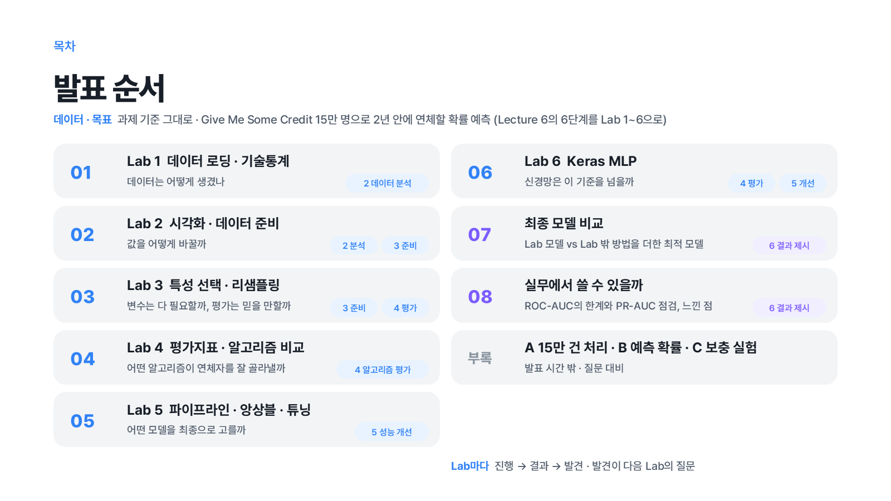
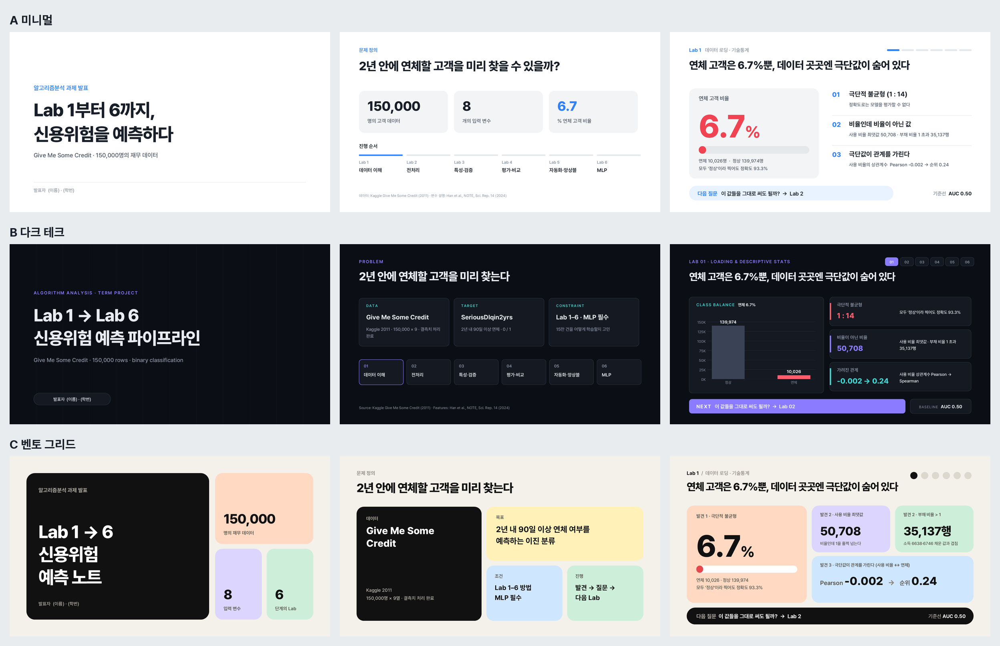
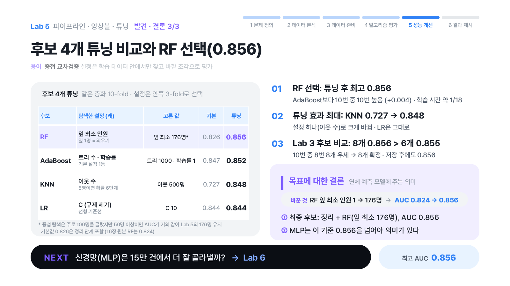
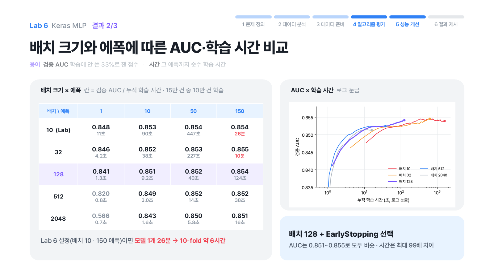
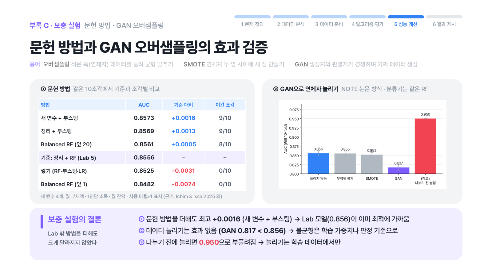
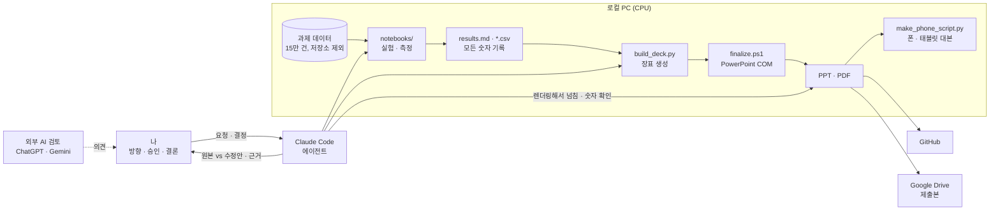

# 신용위험 예측 모델링 (Give Me Some Credit)

알고리즘분석 과제 · 수원대학교 컴퓨터SW학과 강희준 · 2026년 11월

**15만 명의 금융 정보로 2년 안에 연체할 고객을 예측하는 모델을, 수업의 Lab 1~6 방법을 순서대로 적용해 만들고 7분 발표 자료로 정리한 과제입니다. 이 README는 결과 요약과 함께, 8일 동안 무엇을 시도하고 왜 방향을 바꿨는지 적은 개발 일지입니다.**

[발표 자료 PDF](slides/public/credit_presentation.pdf) · [실험 기록](results.md) · [개발 일지](#개발-일지) · [AI 활용 방식](#ai-활용-방식-환경과-구조) · [15만 건 처리](#15만-건을-어떻게-돌렸나) · [실행 방법](#실행-방법)



## 무엇을 하나요?

| 항목 | 내용 |
| --- | --- |
| 데이터 | Kaggle Give Me Some Credit (2011) 과제용 버전. 150,000행 × 9열 (입력 8개 + 정답) |
| 정답 | 2년 안에 90일 이상 연체했는지 (연체 10,026명, 6.68%) |
| 평가 지표 | ROC-AUC. 연체자가 6.68%뿐이라 모두 '정상'이라고 찍어도 정확도가 93.3%가 나오기 때문. 실무 판단은 PR-AUC로 다시 확인 |
| 진행 방식 | Lab 1 → Lab 6 순서대로, 한 Lab에서 발견한 문제가 다음 Lab의 질문이 되도록 |
| 필수 조건 | MLP 사용, 15만 건을 어떻게 학습시킬지 고민한 과정 포함 |

발표 자료의 모든 숫자는 [results.md](results.md)에 기록했고, 노트북을 다시 실행하면 같은 값이 나옵니다(seed 7).

## 결과 요약

| 단계 | 모델 | ROC-AUC (층화 10-fold) | 바뀐 점 |
| --- | --- | ---: | --- |
| 기준 | 모두 '정상'으로 찍기 | 0.500 | |
| Lab 2 | 로그+표준화 + 로지스틱 회귀 | 0.824 | 치우친 4개 변수에 로그 변환 |
| Lab 4 | + 연체자 가중치 | 0.844 | 연체자를 잡는 비율 1.3% → 75% |
| Lab 5 | 데이터 정리 + 랜덤 포레스트 (잎 최소 176명) | 0.856 | 후보 4개(LR·KNN·AdaBoost·RF)를 같은 조건으로 튜닝해 RF 선택 |
| Lab 6 | MLP (12-8, 배치 128, EarlyStopping) | 0.850 | 랜덤 포레스트를 넘지 못함, 학습 시간 10배 |
| Lab 밖 | 새 변수 + 튜닝한 그래디언트 부스팅 | **0.858** | 10조각 모두 우세, 차이는 +0.002 |

- **실무에서 쓸 수 있을까?** ROC-AUC는 정상 고객이 14만 명이라 오판이 작아 보입니다. 정밀도로 보는 PR-AUC로 다시 재니 Lab 모델 0.344, 최적 모델 0.350(찍기 0.067의 약 5배)이었습니다. 판정 기준 0.17에서 연체자 55%를 잡지만 판정한 3명 중 2명은 정상 고객이라, **혼자 판정하기보다 위험 고객을 먼저 골라 주는 선별 도구**로 쓸 수 있다고 결론 냈습니다. 위험 점수 상위 10%만 심사해도 연체자의 51%가 들어옵니다.
- 과제 목적인 '연체 확률'도 맞았습니다. 평균 예측 연체 확률 6.68%로 실제와 같았고, 가장 위험한 10%는 예측 32.4%, 실제 34.2%였습니다.
- MLP, 랜덤 포레스트, 그래디언트 부스팅이 모두 0.85~0.858에 모였습니다. 이번 범위에서는 모델을 바꿔서 얻은 몫보다 판정 기준값을 바꿔서 얻은 몫(손실 31% 감소)이 컸습니다.


## 개발 일지

### 11/10 · 1일차: 환경, Lab 1~4, 발표 형식

- **발표 형식부터 정했습니다.** Lab마다 "진행 → 결과 → 발견·결론" 3장, 마지막 줄의 발견이 다음 Lab의 질문이 되도록. 교수님은 코드가 아니라 장표만 보고 질문하므로, 장표만으로 이해되고 모든 숫자에 답할 수 있게 만드는 것을 기준으로 삼았습니다.
- 디자인은 3가지 안(미니멀 · 다크 · 벤토)을 실제 장표로 만들어 비교한 뒤, 미니멀 바탕에 코드·콘솔만 어둡게 넣는 방식으로 정했습니다. 장표는 `python-pptx` 코드로 만들어 숫자가 바뀌면 다시 빌드합니다.

  

- **Lab 1:** 연체 6.68%. 전부 '정상'이라고 해도 정확도 93%라서, 처음부터 정확도 대신 AUC를 주 지표로 정했습니다. 한도의 5만 배를 썼다는 값, 같은 숫자(6638·6746)로 채운 소득 2만 9천여 행, 나올 수 없는 연체 횟수(96·98)를 찾았습니다.
- **Lab 2:** 같은 변환이 모델마다 정반대였습니다. 로그+표준화는 로지스틱 회귀만(0.787 → 0.824), Binarizer는 결정트리만 올렸습니다.
- **Lab 3:** 시험 데이터를 한 번만 나누면 나누는 방식에 따라 AUC가 0.816~0.828로 흔들렸습니다. 이후 모든 비교를 층화 10-fold(seed 7)로 통일했습니다. LOOCV는 1회 0.49초 × 15만 번 ≈ 20시간이라 대체했습니다.
- **Lab 4:** 정확도 93%인 로지스틱 회귀가 연체자 3,309명 중 **43명**만 잡고 있었습니다. 연체자에 학습 가중치(class_weight)를 주자 75%를 잡았고 AUC도 0.844로 올랐습니다. SVM은 데이터 2배에 시간 약 4배라 1만 건 표본에서 따로 비교했습니다.

  

### 11/11 · 2일차: Lab 5, 최종 모델, Lab 6 준비

- **누수 점검:** 지금까지 표준화를 전체 데이터에 먼저 맞췄던 것을 Pipeline으로 조각 안에 넣어 다시 쟀습니다. 0.8436 → 0.8436, 영향이 없음을 확인했습니다.
- **앙상블:** 결정트리 하나는 0.597이었지만 Bagging 0.819, RF 0.824, AdaBoost 0.847로 올랐습니다. RF의 잎 최소 인원을 튜닝하자 0.856이 됐습니다.
- 최종 RF를 15만 건 전체로 다시 학습하고 저장했습니다(5.5 MB).
- Lab 밖의 그래디언트 부스팅으로 상한을 먼저 확인했습니다. 최고 0.857로 RF와 흔들림 범위 안이라 "이 데이터의 한계 근처"라고 판단했습니다.
- Lab 6 설정(배치 10)이면 모델 하나에 26분, 10-fold면 약 6시간이었습니다. 추정 대신 배치 5종 × 150 에폭을 모두 직접 재는 실험을 끊겨도 이어서 돌 수 있게 짜서 시작했습니다.

### 11/12 · 3일차: Lab 6 MLP, Lab 밖 실험, 최종 비교

- **배치 크기는 성능이 아니라 시간을 결정했습니다.** 150 에폭에서 다섯 배치 모두 AUC 0.851~0.855였고, 시간은 최대 99배 차이였습니다. 배치 128 + EarlyStopping을 골라 배치 10보다 13배 빨라졌습니다.
- **막힌 곳:** Lab 6의 `KerasClassifier`는 Keras 3에서 삭제됐고, 대체재 scikeras는 scikit-learn 1.9에서 AUC 계산이 깨졌습니다. 같은 인터페이스의 래퍼를 직접 만들어 해결했습니다([keras_wrapper.py](notebooks/keras_wrapper.py)).
- MLP는 0.850으로 튜닝한 RF 0.856을 넘지 못했습니다. 변수 8개짜리 표 데이터에서는 트리 앙상블이 더 효율적이었습니다.
- **Lab 밖 실험:** 문헌에서 이 데이터에 효과가 있었다는 방법(새 변수, 부스팅, Balanced RF, 쌓기)과 GAN 오버샘플링을 같은 10조각에서 비교했습니다. GAN으로 연체자를 늘리면 0.817로 떨어졌고, 같은 GAN도 **나누기 전에** 늘리면 시험에 가짜 연체자가 섞여 0.950으로 부풀었습니다. 평가 순서 하나로 점수가 이만큼 달라지는 것을 직접 확인했습니다.
- 장표 제목을 명사형 보고서체로 바꾸고, 용어 풀이는 처음 나온 장에만 넣었습니다.

### 11/15 · 4일차: 장표 가독성

- 22장을 발표 화면 크기로 모아 보고, Lab마다 결론 박스에 "바꾼 것 → 결과" 한 줄을 넣었습니다.

### 11/16 · 5일차: 대본과 전체 재검토

- **대본을 쉬운 말로 다시 썼습니다.** 알고리즘 이름은 남기고 나머지는 풀어 썼습니다. 발표장에서 볼 수 있게 장마다 슬라이드 그림 + 대본 + 예상 질문을 한 쪽에 담은 폰용 PDF를 만들었습니다.
- **Lab 3의 결론을 고쳤습니다.** 변수 6개가 로지스틱 회귀에서 근소하게(+0.002, 10조각 중 9번) 나았는데 "8개를 다 쓴다"로 결론 낸 것이 맞지 않았습니다. 6개·8개를 두 후보로 남기고, Lab 5의 RF에서 같은 조각끼리 비교해 8개로 확정(10조각 중 8번)하도록 흐름을 바꿨습니다.
- **"왜 RF인가?"에 답하도록 Lab 5를 다시 했습니다.** 기본 설정에서는 AdaBoost가 1등이었기 때문에, 후보 4개(LR · KNN · AdaBoost · RF)를 같은 중첩 교차검증(바깥 층화 10-fold, 안쪽 3-fold)으로 튜닝했습니다. 탐색 범위 끝에 걸린 후보는 범위를 넓혀 다시 돌렸습니다. RF 0.856이 AdaBoost(1,000개) 0.852보다 10조각 모두에서 높았고, 학습 시간은 약 1/18이었습니다.

  

- 예측 확률이 실제 연체율과 맞는지 10구간으로 점검했습니다(평균 6.68% = 실제 6.68%). 이 결과가 뒤의 판정 기준 0.17이 이론값 1/6과 거의 같은 이유가 됩니다.
- 발표하지 않는 내용(15만 건 처리 방법, 확률 점검, Lab 밖 실험)은 부록으로 옮겼습니다.

### 11/17 · 6일차: 결론 다시 세우기, 제출

- **결론의 질문을 바꿨습니다.** "Lab 모델과 최적 모델 중 무엇이 나은가"(차이 0.002)에서 "이 모델을 실무에서 쓸 수 있을까?"로. Lab 4에서 AUC 0.844가 '좋음'이었는데도 판정한 사람 중 진짜 연체자는 20%였던 것을 다시 가져와 ROC-AUC의 한계를 설명하고, 같은 10조각으로 PR-AUC를 재서 결론을 "위험 고객 선별 도구"로 정했습니다.
- 목차와 문제 정의를 한 장으로 합치고(데이터·목표는 청중이 이미 아는 내용), 본문을 22장 + 부록 3장으로 줄였습니다. 예상 질문도 정말 나올 만한 것만 남겼습니다.
- **질문 방어용 수치를 통일했습니다.** 장마다 달랐던 RF 학습 시간(3초/4초/5초)을 같은 실행에서 잰 값으로 맞추고, 측정 조건이 다른 숫자는 비율이나 각주로 구분했습니다.
- 소리 내어 읽을 때 걸리는 문장을 다듬고, 폰 대본에 핵심 수치 굵게 · 부록 쪽 번호 표시를 넣었습니다. 대본 예상 6분 56초로 제출했습니다.

### 돌아보며

- 데이터 형식, 전처리, 알고리즘, 평가 지표를 바꿀 때마다 결과가 달라졌습니다. 그중 결과를 가장 크게 바꾼 것은 모델이 아니라 **평가 지표(정확도 → AUC → PR-AUC)와 판정 기준**이었습니다.
- 신경망이라고 당연히 좋은 것은 아니었습니다(MLP 0.850 < RF 0.856).
- 오래 걸리는 실험은 추정하지 않고 먼저 작은 표본으로 끝까지 돌려 본 뒤 실제로 쟀습니다. 그 숫자가 LOOCV 대체, SVM 표본, 배치 128 같은 결정의 근거가 됐습니다.

## 진행 흐름

| Lab | 질문 | 한 일 | 발견 → 다음 질문 |
| --- | --- | --- | --- |
| 1 데이터 로딩·기술통계 | 데이터가 어떻게 생겼나? | 기술통계, 클래스 분포, 상관, 왜도 | 연체 6.7%, 소득 대체값(6638/6746) 29,737행, 불가능한 연체 횟수(96/98) 269행 → 값을 어떻게 바꿔야 하나? |
| 2 시각화·데이터 준비 | 어떤 변환이 맞나? | 분포 그림, MinMax·표준화·Normalizer·Binarizer·로그 비교 | 로그+표준화는 회귀에만, Binarizer는 트리에만 효과 → 변수가 다 필요한가? |
| 3 특성 선택·리샘플링 | 변수를 줄일까? 어떻게 시험할까? | SelectKBest, RFE, PCA, 트리 중요도 / 분할, k-fold, LOOCV, ShuffleSplit | 6개·8개 두 후보로 넘김(Lab 5에서 8개 확정), 한 번 분할은 흔들림 → 층화 10-fold로 통일 |
| 4 평가지표·알고리즘 비교 | 무엇으로 재고 무엇을 고르나? | 정확도·logloss·AUC·혼동행렬, LR·LDA·KNN·CART·NB·SVM | 연체자 43명만 잡던 문제를 가중치로 해결 → 더 올릴 수 있나? |
| 5 파이프라인·앙상블·튜닝 | 누수는 없었나? 무엇을 최종으로? | Pipeline, Bagging·RF·AdaBoost·Voting, 후보 4개 중첩 튜닝, 모델 저장 | 누수 영향 없음, 튜닝한 RF 0.856 → 신경망은 넘을까? |
| 6 Keras MLP | 15만 건으로 어떻게 학습시키나? | 배치 5종 × 150 에폭 측정, 10-fold, KerasClassifier, Grid Search | 배치 128로 13배 단축, MLP 0.850 → RF 유지 |
| 최종 | 실무에서 쓸 수 있나? | Lab 밖 방법과 비교, PR-AUC, 비용 기준 판정값 | 선별 도구로 사용, 기준 0.17에서 손실 31% 감소 |

## 15만 건을 어떻게 돌렸나

Lab 자료의 예제는 768건짜리 데이터 기준이라, 15만 건에 그대로 쓰면 오래 걸리는 단계가 있었습니다. 데이터는 줄이지 않고 먼저 시간을 잰 뒤 방법을 바꿨습니다.

| 단계 | Lab 그대로 쓰면 | 한 일 |
| --- | --- | --- |
| Lab 3 LOOCV | 1회 학습 0.49초 × 15만 회 ≈ 20시간, 조각별 AUC 계산 불가 | 층화 10-fold로 대체 (1,000건 표본으로 정확도만 확인) |
| Lab 4 SVM | 데이터 2배에 시간 약 4배, 10-fold 약 1시간 | 1만 건 층화 표본에서 6개 알고리즘을 함께 비교 |
| Lab 5 튜닝 | 후보 4개 × 설정 × 10-fold | 안쪽 3-fold로 설정을 고르고 병렬 계산 |
| Lab 6 MLP | 배치 10 · 150 에폭이면 모델 1개 26분, 10-fold 약 6시간 | 배치 5종을 150 에폭까지 모두 측정해 배치 128 + EarlyStopping (fold당 67초) |
| Lab 6 Grid Search | 54가지 × 3-fold, 이틀 이상 | 배치·에폭은 위 실험으로 정하고 optimizer × 초기화 6가지만 탐색 |

배치 크기 실험 결과(검증 AUC / 누적 학습 시간):

| 배치 | 1 에폭 | 10 에폭 | 50 에폭 | 150 에폭 |
| --- | --- | --- | --- | --- |
| 10 (Lab) | 0.848 / 11초 | 0.853 / 90초 | 0.854 / 447초 | 0.854 / 26분 |
| 128 | 0.841 / 1.3초 | 0.851 / 9초 | 0.852 / 40초 | 0.854 / 124초 |
| 2048 | 0.566 / 0.7초 | 0.843 / 1.6초 | 0.850 / 5.8초 | 0.851 / 16초 |



## Lab 밖 실험과 최종 비교

| 방법 | AUC | 기준 대비 | 이긴 조각 |
| --- | ---: | ---: | ---: |
| 새 변수 + 그래디언트 부스팅 | 0.8573 | +0.0016 | 9/10 |
| Balanced RF (잎 20) | 0.8561 | +0.0005 | 8/10 |
| 기준: 데이터 정리 + RF (Lab 5) | 0.8556 | | |
| 쌓기 (RF·부스팅·LR → LR) | 0.8525 | -0.0031 | 0/10 |
| GAN으로 연체자 늘리기 + RF | 0.8172 | -0.0384 | 0/10 |

새 변수 4개는 월 부채액, 1인당 소득, 월 잔액, 사용 비율 > 1 표시입니다. 효과가 있던 방법만 모은 최적 모델은 중첩 교차검증(설정은 각 조각의 학습 데이터 안에서만 탐색)으로 평가했습니다.

| | Lab 기반 (정리 + RF) | 최적 (새 변수 + 부스팅) |
| --- | --- | --- |
| ROC-AUC | 0.8556 | 0.8576 (10조각 모두 우세) |
| PR-AUC | 0.344 | 0.350 (10조각 모두 우세) |
| 15만 건 학습 · 1,000명 예측 | 5.0초 · 42ms | 4.6초 · 13ms |
| 파일 크기 | 5.5 MB | 0.6 MB |
| 손실 (비용 5:1, 기준 0.17) | 34,000 | 33,830 (-0.5%) |



## 저장소 구성

```
credit_project/
├── notebooks/                 실험 (번호 순서대로 실행)
│   ├── 01_lab1_loading_stats.ipynb
│   ├── 02_lab2_preparing_data.ipynb
│   ├── 03_lab3_feature_selection_resampling.ipynb
│   ├── 04_lab4_metrics_algorithms.ipynb
│   ├── 05_lab5_pipeline_ensemble_tuning.ipynb
│   ├── 05b_lab5_final_model_full.ipynb      최종 RF를 15만 건 전체로 학습
│   ├── 05c_feature_count_check.py           Lab 3 변수 후보 6개 vs 8개 비교
│   ├── 05d_candidate_tuning.py              후보 4개 중첩 튜닝 비교
│   ├── 06a_batch_epoch_experiment.py        배치 × 에폭 실험 (끊겨도 이어서 실행)
│   ├── 06_lab6_mlp.ipynb
│   ├── 07_literature_models.ipynb           Lab 밖: 문헌 방법
│   ├── 08_gan_oversampling.ipynb            Lab 밖: GAN 오버샘플링
│   ├── 09_optimal_vs_lab.ipynb              최종 비교, 비용 기준 판정값
│   ├── 09b_calibration.py                   예측 확률과 실제 연체율 비교
│   ├── 09c_pr_auc.py                        PR-AUC와 판정 기준별 정밀도·재현율
│   ├── keras_wrapper.py                     Keras 3용 KerasClassifier
│   └── *.csv                                조각별 점수 등 실험 결과
├── figures/                   노트북이 만든 그림, Lab 자료 캡처(lab_captures/)
├── slides/
│   ├── build_deck.py          발표 자료 생성 (python-pptx) → _draft.pptx, script.md
│   ├── finalize.ps1           진입 애니메이션, 글꼴 포함 저장, PDF (PowerPoint 필요)
│   ├── lab_capture.py         Lab PDF에서 코드 부분 캡처
│   ├── public/                발표 자료 공개본 PPT·PDF (본문 22장 + 부록 3장, 표지 학번 제외)와 장별 PNG
│   ├── script_edit.md         발표 대본·예상 질문 (제출 뒤에도 이 파일만 고침)
│   ├── make_phone_script.py   script_edit.md → 폰용 대본 PDF
│   ├── script_phone.pdf       폰용 대본 (장마다 그림 + 대본 + 짧은 예상 질문, 부록 포함)
│   ├── script_tablet.pdf      태블릿용 대본 (같은 구성, 예상 질문을 자세한 답으로)
│   ├── qa_short.py            예상 질문 요약 원본
│   └── render_png.ps1         PPT 각 장을 PNG로 내보내기
├── docs/images/               README용 그림
├── results.md                 모든 실험 숫자 기록 (전체 실험 목록 38개)
└── requirements.txt
```

## 실행 방법

**준비물: Python 3.13, Windows (발표 자료의 애니메이션·PDF 단계는 PowerPoint 필요).**

```sh
python -m venv .venv
.venv\Scripts\activate
pip install -r requirements.txt
python -m ipykernel install --user --name credit-project
```

1. 과제용 데이터 파일을 `data/givemesomecredit.csv`에 둡니다. Kaggle 데이터라 저장소에는 넣지 않았습니다. 첫 줄이 열 이름이고, 열은 `SeriousDlqin2yrs, RevolvingUtilizationOfUnsecuredLines, age, NumberOfTime30-59DaysPastDueNotWorse, DebtRatio, MonthlyIncome, NumberOfDependents, CombinedDefaulted, CombinedCreditLoans` 순서입니다.
2. 노트북을 번호 순서대로 실행합니다. 커널은 `credit-project`입니다.
   ```sh
   cd notebooks
   jupyter nbconvert --to notebook --execute --inplace --ExecutePreprocessor.kernel_name=credit-project 01_lab1_loading_stats.ipynb
   ```
   오래 걸리는 것: 05 약 20분, 05d 약 1시간, 06a 약 1시간, 06 약 50분, 07 약 40분, 09 약 15분 (CPU 기준).
3. 발표 자료를 만듭니다. 글꼴은 [Pretendard](https://github.com/orioncactus/pretendard)를 씁니다.
   ```sh
   cd slides
   python build_deck.py
   powershell -ExecutionPolicy Bypass -File finalize.ps1
   ```
4. 대본만 고칠 때 (PPT는 그대로): `slides/script_edit.md`를 고친 뒤 실행합니다. `**93%**`처럼 감싸면 굵게 나옵니다.
   ```sh
   cd slides
   python make_phone_script.py            # 폰용
   python make_phone_script.py --tablet   # 태블릿용 (자세한 질문·답)
   ```

## 알려진 한계

- 과제용 데이터는 원본 Kaggle 데이터의 연체 횟수 3개 열을 0/1 하나로 합친 버전이라, 원본으로 한 연구(최고 약 0.87)와 숫자를 직접 비교하지 않았습니다.
- 비용 비율 5:1은 신용평가 연구에서 흔히 쓰는 가정입니다. 실제 은행의 대출 금액과 이자 수익으로 정하면 기준값이 달라집니다. 기준 0.17은 같은 교차검증 예측에서 찾은 값이라 약간 낙관적일 수 있습니다.
- GAN은 강의의 기본 구조로 단순화했습니다. Han et al.(2024) NOTE의 오토인코더 + 조건부 WGAN과는 다르므로, 그 논문 결과를 재현한 것이 아닙니다.
- 날짜 정보가 없어서 다른 시기의 고객에게도 같은 성능이 나오는지는 확인할 수 없습니다.

## AI 활용 방식: 환경과 구조

이 과제는 AI 코딩 에이전트(Claude Code)와 함께 진행했습니다. 방향과 결론은 직접 정하고, 실험 실행 · 코드 작성 · 장표 생성 · 검증의 반복은 에이전트에게 맡기는 구조였습니다. 커밋의 `Co-Authored-By`가 그 기록입니다.

### 개발 환경

| 구분 | 내용 |
| --- | --- |
| 하드웨어 | 노트북 CPU 전용 (Intel i5-1135G7, RAM 16 GB), GPU 없음 |
| OS · 셸 | Windows 11, PowerShell · Git Bash |
| AI 에이전트 | Claude Code (Claude 데스크톱 앱의 Code 탭), 모델 Claude Opus |
| 에이전트가 쓴 도구 | 터미널(Python 실행, 백그라운드 장시간 실행), 파일 읽기·수정, git · GitHub CLI, Google Drive 연결(제출본 업로드), 화면 렌더링 확인 |
| 실험 | Python 3.13, scikit-learn 1.9, Keras 3 (TensorFlow 2.21), pandas, matplotlib, Jupyter (`nbconvert`로 비대화식 실행) |
| 발표 자료 | python-pptx로 장표를 코드로 생성 → PowerPoint COM(PowerShell)으로 애니메이션 · 글꼴 포함 · PDF → Pillow로 폰·태블릿 대본 PDF |
| 교차 검토 | 다른 AI(ChatGPT, Gemini)의 검토 의견을 받아, 에이전트가 실험 기록과 대조한 뒤 맞는 것만 반영 |

### 작업 구조



- **숫자의 흐름이 한 방향입니다.** 실험 출력 → `results.md`·CSV → 장표 코드 → PPT. 장표의 숫자를 손으로 치지 않고 CSV에서 읽어 와서, 실험을 다시 돌리면 장표도 같이 바뀝니다.
- **장시간 실험은 에이전트가 백그라운드로 돌렸습니다.** 중첩 튜닝(약 1시간), 배치 × 에폭(약 1시간)은 끊겨도 이어서 돌 수 있게 짜고, 작은 표본으로 먼저 끝까지 돌려 오류를 확인한 뒤 전체를 실행했습니다.
- **장표는 이미지로 렌더링해 확인했습니다.** 글자 넘침, 겹침, 숫자 불일치를 에이전트가 PNG로 보고 고친 뒤 다시 빌드했습니다.

### 역할 나눔

| 내가 한 것 | 에이전트가 한 것 |
| --- | --- |
| 발표 구성 (Lab마다 발견 → 다음 질문), 장표에 넣을 내용 | 노트북 · 실험 스크립트 작성과 실행, 시간 측정 |
| 실험 방향: 배치 크기를 직접 재기, 최종 모델 15만 건 재학습, 학습 시간을 비교에 넣기, Lab 3 결정을 Lab 5로 넘기기, 후보 4개를 같은 조건으로 튜닝하기 | 결과 기록(`results.md`), 장표 · 대본 생성 코드, 렌더링 확인 |
| 결론 방향: "실무에서 쓸 수 있을까?"로 바꾸고 PR-AUC로 확인 | 문장 · 수치 일관성 점검, 예상 질문 정리 |
| 모든 수정의 승인, 외부 AI 의견 중 무엇을 받을지 결정 | 외부 의견을 데이터와 대조해 맞는 것 / 틀린 것 구분 |

### 에이전트를 다룬 규칙

- **수정 전 승인:** 판단이 필요한 수정은 원본과 수정안을 나란히 보여 주고 승인받은 뒤 고치게 했습니다. 밤새 맡긴 전체 재검토만 "고치고 기록"을 허용했고, 바뀐 것을 원본 → 수정 표로 남기게 했습니다.
- **숫자는 기록에서만:** 요청한 숫자가 실험 기록과 다르면 그대로 바꾸지 말고 이유를 말하게 했습니다. 예: 다른 실행에서 잰 학습 시간(4초 vs 71초)을 한 장에서 섞지 않고 같은 실행의 비율(약 1/18)로 표기.
- **외부 AI 의견도 검증:** 예: "심사 인력의 10%만 쓰고도"라는 제안은 실제 의미(위험 점수 상위 10%의 고객)와 달라 받지 않았습니다.
- **에이전트가 먼저 잡은 문제:** scikeras가 scikit-learn 1.9에서 AUC를 잘못 계산하는 문제(→ 래퍼 직접 작성), 장마다 다르게 적힌 학습 시간, 실제로 만들지 않은 변수 이름 등.
- **결정의 기록:** 프로젝트 방향과 사용자 규칙은 에이전트의 프로젝트 메모리에, 실험 결과는 `results.md`에 남겨 세션이 바뀌어도 같은 기준으로 이어 갔습니다.

### 결과를 믿을 수 있도록 지킨 것

- 모든 비교를 같은 층화 10-fold(seed 7)로 하고, 같은 조각끼리 비교했습니다. 차이가 흔들림보다 작으면 우열을 주장하지 않았습니다.
- 전처리, 튜닝, 데이터 늘리기는 각 조각의 학습 데이터 안에서만 했습니다.
- 발표 자료의 숫자는 [results.md](results.md)와 실험 출력에서만 가져왔고, 측정 조건이 다른 숫자는 섞지 않았습니다.

## 참고 자료

- 알고리즘분석 Lab 1~6, Lecture 2~7 (수원대학교 한성일 교수)
- Han, S. et al. (2024). NOTE: non-parametric oversampling technique for explainable credit scoring. *Scientific Reports*, 14, 26070.
- Han, S., Jung, H. (2024). NATE: Non-pArameTric approach for Explainable credit scoring on imbalanced class. *PLOS ONE*, 19(12).
- Ichim, B., Issa, B. (2025). Improving Machine Learning Performance in Credit Scoring by Data Analysis and Data Pre-Processing. *ICAART 2025*.
- [Kaggle: Give Me Some Credit (2011)](https://www.kaggle.com/competitions/GiveMeSomeCredit)
