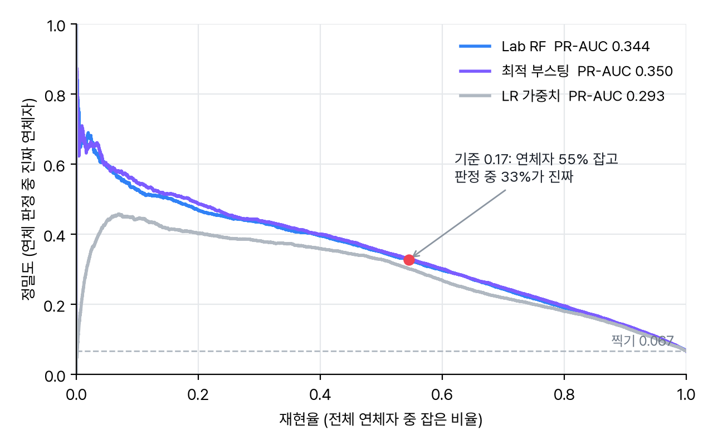
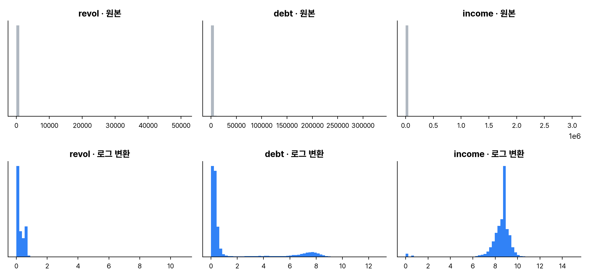
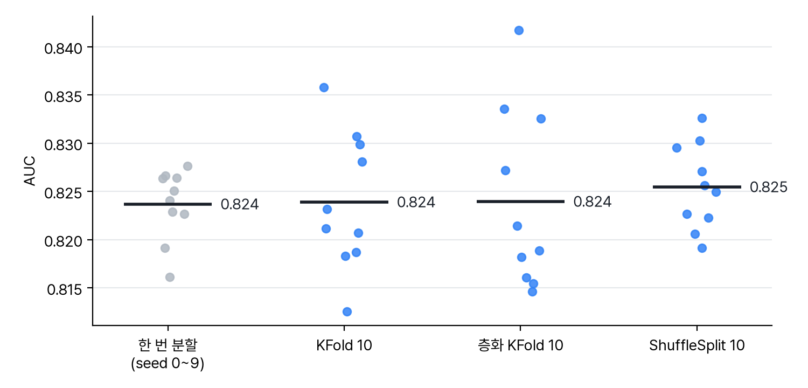
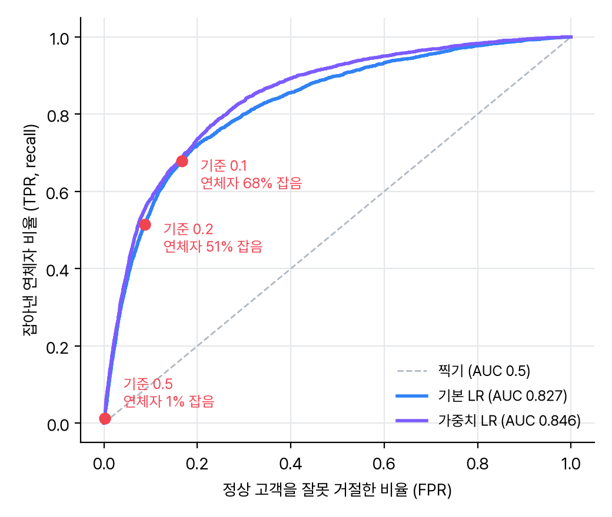
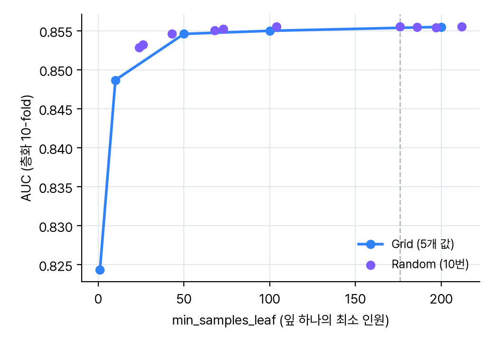
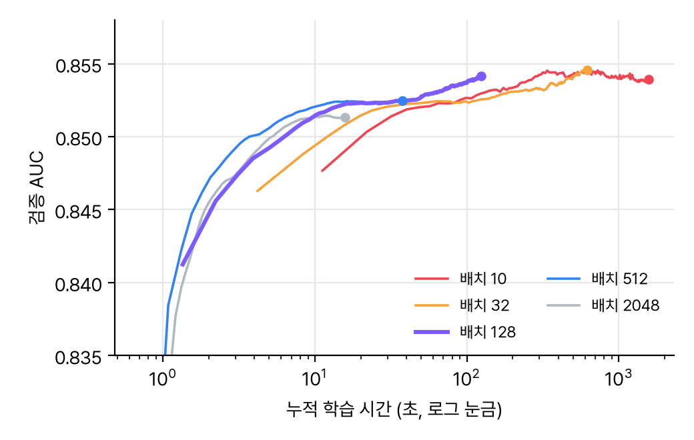
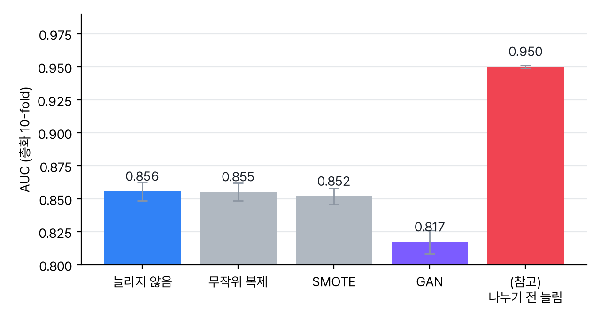

# 신용위험 예측 모델링 (Give Me Some Credit)

알고리즘분석 과제 · 수원대학교 컴퓨터SW학과 강희준 · 2026년 11월

**15만 명의 금융 정보로 2년 안에 연체할 고객을 예측하는 모델을, 수업의 Lab 1~6 방법을 순서대로 적용해 만든 과제입니다. 한 Lab에서 발견한 문제가 다음 Lab의 질문이 되도록 진행했고, 이 README에는 Lab마다 알게 된 것과 개발 과정을 정리했습니다.**

[실험 기록](results.md) · [Lab별로 알게 된 것](#lab별로-알게-된-것) · [개발 일지](#개발-일지) · [15만 건 처리](#15만-건을-어떻게-돌렸나) · [실행 방법](#실행-방법) · 참고: [발표 자료 PDF](slides/public/credit_presentation.pdf)

## 무엇을 하나요?

| 항목 | 내용 |
| --- | --- |
| 데이터 | Kaggle Give Me Some Credit (2011) 과제용 버전. 150,000행 × 9열 (입력 8개 + 정답) |
| 정답 | 2년 안에 90일 이상 연체했는지 (연체 10,026명, 6.68%) |
| 평가 지표 | ROC-AUC. 연체자가 6.68%뿐이라 모두 '정상'이라고 찍어도 정확도가 93.3%가 나오기 때문. 실무 판단은 PR-AUC로 다시 확인 |
| 진행 방식 | Lab 1 → Lab 6 순서대로, 한 Lab에서 발견한 문제가 다음 Lab의 질문이 되도록 |
| 필수 조건 | MLP 사용, 15만 건을 어떻게 학습시킬지 고민한 과정 포함 |
| 환경 | 노트북 CPU 전용 (i5-1135G7, RAM 16 GB), Python 3.13, scikit-learn 1.9, Keras 3 (TensorFlow 2.21) |

모든 숫자는 [results.md](results.md)에 기록했고, 노트북을 다시 실행하면 같은 값이 나옵니다(seed 7).

## 결과 요약

| 단계 | 모델 | ROC-AUC (층화 10-fold) | 바뀐 점 |
| --- | --- | ---: | --- |
| 기준 | 모두 '정상'으로 찍기 | 0.500 | |
| Lab 2 | 로그+표준화 + 로지스틱 회귀 | 0.824 | 치우친 4개 변수에 로그 변환 |
| Lab 4 | + 연체자 가중치 | 0.844 | 연체자를 잡는 비율 1.3% → 75% |
| Lab 5 | 데이터 정리 + 랜덤 포레스트 (잎 최소 176명) | 0.856 | 후보 4개(LR·KNN·AdaBoost·RF)를 같은 조건으로 튜닝해 RF 선택 |
| Lab 6 | MLP (12-8, 배치 128, EarlyStopping) | 0.850 | 랜덤 포레스트를 넘지 못함, 학습 시간 10배 |
| Lab 밖 | 새 변수 + 튜닝한 그래디언트 부스팅 | **0.858** | 10조각 모두 우세, 차이는 +0.002 |

- **실무에서 쓸 수 있을까?** ROC-AUC는 정상 고객이 14만 명이라 오판이 작아 보입니다. 정밀도로 보는 PR-AUC로 다시 재니 Lab 모델 0.344, 최적 모델 0.350(찍기 0.067의 약 5배)이었습니다. 판정 기준 0.17에서 연체자 55%를 잡지만 판정한 3명 중 2명은 정상 고객이라, **혼자 판정하기보다 위험 고객을 먼저 골라 주는 선별 도구**로 쓸 수 있다고 결론 냈습니다. 위험 점수 상위 10%만 심사해도 연체자의 51%가 들어옵니다.
- 과제 목적인 '연체 확률'도 맞았습니다. 평균 예측 연체 확률 6.68%로 실제와 같았고, 가장 위험한 10%는 예측 32.4%, 실제 34.2%였습니다.
- MLP, 랜덤 포레스트, 그래디언트 부스팅이 모두 0.85~0.858에 모였습니다. 이번 범위에서는 모델을 바꿔서 얻은 몫보다 판정 기준값을 바꿔서 얻은 몫(손실 31% 감소)이 컸습니다.



## Lab별로 알게 된 것

### Lab 1 · 데이터 로딩과 기술통계

- **적용:** `read_csv`, `shape`·`dtypes`·`describe`, 클래스 분포, Pearson·Spearman 상관, 왜도
- **알게 된 것:** 연체는 6.68%뿐이라 정확도로는 모델을 평가할 수 없었습니다. 한도의 5만 배를 썼다는 사용 비율, 같은 숫자(6638·6746)로 채운 소득 29,737행, 나올 수 없는 연체 횟수(96·98) 269행처럼 숫자만으로는 드러나지 않는 이상값이 있었습니다. 사용 비율은 Pearson으로는 연체와 관계가 없어 보였지만(-0.002) 순위로 보면(Spearman 0.240) 세 번째로 강한 변수였습니다. 극단값이 관계를 가린 것입니다.
- **다음 질문:** 치우친 값을 어떻게 바꿔야 하나? → Lab 2

### Lab 2 · 시각화와 데이터 준비

- **적용:** 히스토그램·밀도·박스·상관행렬·산점도, MinMax·표준화·Normalizer·Binarizer, 로그 변환
- **알게 된 것:** 같은 변환도 모델에 따라 효과가 정반대였습니다. 로그+표준화는 로지스틱 회귀만 0.787 → 0.824로 올렸고, Binarizer는 결정트리만 올렸습니다. 트리는 값의 순서로만 나누기 때문에 단위나 로그를 바꿔도 결과가 같습니다. 로그 변환으로 부채 비율의 왜도가 95.2 → 1.7로 줄었습니다.
- **다음 질문:** 변수 8개가 다 필요한가? 평가는 믿을 만한가? → Lab 3



### Lab 3 · 특성 선택과 리샘플링

- **적용:** SelectKBest(chi2), RFE, PCA, 트리 중요도 / train_test_split, k-fold, LOOCV, ShuffleSplit
- **알게 된 것:** 방법마다 고른 변수가 달랐습니다. 통계 검정은 값이 큰 소득을, 트리는 값의 종류가 많은 변수를 높게 쳤습니다. 변수 6개는 로지스틱 회귀에서 근소하게 나았지만(+0.002, 10조각 중 9번), 다른 모델에서는 다를 수 있어 6개·8개를 두 후보로 넘겼습니다. 시험 데이터를 한 번만 나누면 AUC가 0.816~0.828로 흔들려서, 이후 모든 비교를 연체 비율을 맞춘 층화 10-fold(seed 7)로 통일했습니다.
- **다음 질문:** 무엇으로 재고 어떤 알고리즘을 고를까? → Lab 4



### Lab 4 · 평가지표와 알고리즘 비교

- **적용:** 정확도·logloss·AUC·혼동행렬·분류 리포트, LR·LDA·KNN·CART·NB·SVM
- **알게 된 것:** 정확도 93%인 로지스틱 회귀가 연체자 3,309명 중 **43명(1.3%)** 만 잡고 있었습니다. 학습할 때 연체자를 틀리면 더 큰 벌점을 주는 가중치(class_weight)를 쓰자 75%를 잡았고 AUC도 0.844로 올랐습니다. 알고리즘 중에서는 LDA 0.832가 가장 높았고, 결정트리 하나는 학습 데이터를 외워 0.595에 그쳤습니다.
- **다음 질문:** 지금까지의 평가는 공정했나? 트리를 합치면 오를까? → Lab 5



### Lab 5 · 파이프라인, 앙상블, 튜닝

- **적용:** Pipeline, FeatureUnion, Bagging·RandomForest·AdaBoost·Voting, GridSearchCV·RandomizedSearchCV, pickle·joblib 저장
- **알게 된 것:** 표준화를 조각 안으로 옮겨(Pipeline) 누수를 막아도 AUC는 0.8436 그대로였습니다. 15만 건에서는 조각마다 평균·표준편차가 거의 같기 때문입니다. 결정트리 하나는 0.597이었지만 여러 개를 합치자 0.82~0.85로 올랐습니다. 기본 설정 1등은 AdaBoost였지만, 후보 4개를 같은 중첩 교차검증으로 튜닝하니 RF 0.856 > AdaBoost 0.852 > KNN 0.848 > LR 0.844였고, RF가 10조각 모두에서 높았고 학습도 약 18배 빨랐습니다. Lab 3에서 넘긴 변수 후보도 RF에서는 8개가 나아(10조각 중 8번) 8개로 확정했습니다.
- **다음 질문:** 신경망은 이 기준을 넘을까? → Lab 6



### Lab 6 · Keras MLP

- **적용:** Sequential MLP, 배치·에폭, k-fold, KerasClassifier, GridSearchCV
- **알게 된 것:** 배치 크기는 성능이 아니라 시간을 결정했습니다. 150 에폭에서 다섯 배치 모두 AUC 0.851~0.855였고 시간은 최대 99배 차이였습니다. 배치 128 + EarlyStopping으로 Lab 설정(배치 10)보다 13배 빨라졌습니다. MLP는 0.850으로 튜닝한 RF 0.856을 넘지 못했고 학습은 10배 느렸습니다. 변수 8개짜리 표 데이터에서는 트리 앙상블이 더 효율적이었습니다.
- **결론:** Lab 범위의 최종 모델은 데이터 정리 + 랜덤 포레스트



## 개발 일지

### 11/10 · 1일차: 환경, Lab 1~4

- Python 3.13 가상환경과 노트북 구조를 만들고, 모든 숫자를 `results.md`에 기록하는 규칙을 정했습니다.
- Lab 1~4를 적용했습니다. 정확도의 함정(93%인데 연체자 1.3%만 탐지)을 확인하고 주 지표를 AUC로 정했습니다.
- LOOCV는 1회 학습 0.49초 × 15만 번 ≈ 20시간이라 층화 10-fold로 대체했고, SVM은 데이터 2배에 시간이 약 4배로 늘어 1만 건 표본에서 따로 비교했습니다.

### 11/11 · 2일차: Lab 5, 최종 모델

- Pipeline으로 누수 영향을 점검하고(차이 없음), 앙상블과 튜닝으로 RF 0.856을 얻었습니다.
- 최종 RF를 15만 건 전체로 다시 학습해 저장했습니다(5.5 MB).
- Lab 밖의 그래디언트 부스팅으로 상한을 먼저 확인했습니다. 최고 0.857로 RF와 흔들림 범위 안이라 "이 데이터의 한계 근처"라고 판단했습니다.
- Lab 6 설정(배치 10)이면 모델 하나에 26분, 10-fold면 약 6시간이었습니다. 추정 대신 배치 5종 × 150 에폭을 모두 직접 재는 실험을 끊겨도 이어서 돌 수 있게 짜서 시작했습니다.

### 11/12 · 3일차: Lab 6 MLP, Lab 밖 실험

- 배치 실험 결과로 배치 128 + EarlyStopping을 골랐습니다.
- **막힌 곳:** Lab 6의 `KerasClassifier`는 Keras 3에서 삭제됐고, 대체재 scikeras는 scikit-learn 1.9에서 AUC 계산이 깨졌습니다. 같은 인터페이스의 래퍼를 직접 만들어 해결했습니다([keras_wrapper.py](notebooks/keras_wrapper.py)).
- 문헌에서 이 데이터에 효과가 있었다는 방법(새 변수, 부스팅, Balanced RF, 쌓기)과 GAN 오버샘플링을 같은 10조각에서 비교했습니다. GAN으로 연체자를 늘리면 0.817로 떨어졌고, 같은 GAN도 **나누기 전에** 늘리면 시험에 가짜 연체자가 섞여 0.950으로 부풀었습니다. 평가 순서 하나로 점수가 이만큼 달라지는 것을 직접 확인했습니다.
- Lab 모델과 최적 모델을 중첩 교차검증으로 비교하고, 비용 기준(놓친 연체자 1명 = 거절한 정상 고객 5명)으로 판정값을 찾았습니다.

### 11/16 · 4일차: 결정 다시 검증하기

- **Lab 3의 결론을 고쳤습니다.** 변수 6개가 근소하게 나았는데 "8개를 다 쓴다"로 결론 낸 것이 맞지 않았습니다. 6개·8개를 두 후보로 남기고, Lab 5의 RF에서 같은 조각끼리 비교해 8개로 확정했습니다.
- **"왜 RF인가?"를 다시 검증했습니다.** 기본 설정에서는 AdaBoost가 1등이었기 때문에, 후보 4개를 같은 중첩 교차검증(바깥 층화 10-fold, 안쪽 3-fold)으로 튜닝했습니다. 탐색 범위 끝에 걸린 후보(AdaBoost, KNN)는 범위를 넓혀 다시 돌렸습니다. AdaBoost는 트리를 300 → 1,000개로 늘려도 +0.001이었습니다.
- 예측 확률이 실제 연체율과 맞는지 10구간으로 점검했습니다(평균 6.68% = 실제 6.68%). 판정 기준 0.17이 이론값 1/(5+1) ≈ 0.167과 거의 같은 이유가 이것입니다.

### 11/17 · 5일차: 평가 지표 다시 보기

- ROC-AUC 0.844로 '좋음'이던 가중치 모델도 연체로 판정한 사람 중 진짜 연체자는 20%였습니다. 정상 고객이 많으면 ROC-AUC가 오판을 작게 보이게 한다는 것을 확인하고, 같은 10조각으로 PR-AUC를 다시 쟀습니다(Lab 0.344, 최적 0.350).
- 결론을 "어느 모델이 나은가"(차이 0.002)에서 "실무에서 어떻게 쓸 수 있나"(위험 고객 선별, 상위 10%에 연체자 51%)로 정리했습니다.

### 돌아보며

- 데이터 형식, 전처리, 알고리즘, 평가 지표를 바꿀 때마다 결과가 달라졌습니다. 그중 결과를 가장 크게 바꾼 것은 모델이 아니라 **평가 지표(정확도 → ROC-AUC → PR-AUC)와 판정 기준**이었습니다.
- 신경망이라고 당연히 좋은 것은 아니었습니다(MLP 0.850 < RF 0.856).
- 오래 걸리는 실험은 추정하지 않고 작은 표본으로 먼저 끝까지 돌려 본 뒤 실제로 쟀습니다. 그 숫자가 LOOCV 대체, SVM 표본, 배치 128 같은 결정의 근거가 됐습니다.

## 15만 건을 어떻게 돌렸나

Lab 자료의 예제는 768건짜리 데이터 기준이라, 15만 건에 그대로 쓰면 오래 걸리는 단계가 있었습니다. 데이터는 줄이지 않고 먼저 시간을 잰 뒤 방법을 바꿨습니다.

| 단계 | Lab 그대로 쓰면 | 한 일 |
| --- | --- | --- |
| Lab 3 LOOCV | 1회 학습 0.49초 × 15만 회 ≈ 20시간, 조각별 AUC 계산 불가 | 층화 10-fold로 대체 (1,000건 표본으로 정확도만 확인) |
| Lab 4 SVM | 데이터 2배에 시간 약 4배, 10-fold 약 1시간 | 1만 건 층화 표본에서 6개 알고리즘을 함께 비교 |
| Lab 5 튜닝 | 후보 4개 × 설정 × 10-fold | 안쪽 3-fold로 설정을 고르고 병렬 계산 |
| Lab 6 MLP | 배치 10 · 150 에폭이면 모델 1개 26분, 10-fold 약 6시간 | 배치 5종을 150 에폭까지 모두 측정해 배치 128 + EarlyStopping (fold당 67초) |
| Lab 6 Grid Search | 54가지 × 3-fold, 이틀 이상 | 배치·에폭은 위 실험으로 정하고 optimizer × 초기화 6가지만 탐색 |

배치 크기 실험 결과(검증 AUC / 누적 학습 시간):

| 배치 | 1 에폭 | 10 에폭 | 50 에폭 | 150 에폭 |
| --- | --- | --- | --- | --- |
| 10 (Lab) | 0.848 / 11초 | 0.853 / 90초 | 0.854 / 447초 | 0.854 / 26분 |
| 128 | 0.841 / 1.3초 | 0.851 / 9초 | 0.852 / 40초 | 0.854 / 124초 |
| 2048 | 0.566 / 0.7초 | 0.843 / 1.6초 | 0.850 / 5.8초 | 0.851 / 16초 |

## Lab 밖 실험과 최종 비교

| 방법 | AUC | 기준 대비 | 이긴 조각 |
| --- | ---: | ---: | ---: |
| 새 변수 + 그래디언트 부스팅 | 0.8573 | +0.0016 | 9/10 |
| Balanced RF (잎 20) | 0.8561 | +0.0005 | 8/10 |
| 기준: 데이터 정리 + RF (Lab 5) | 0.8556 | | |
| 쌓기 (RF·부스팅·LR → LR) | 0.8525 | -0.0031 | 0/10 |
| GAN으로 연체자 늘리기 + RF | 0.8172 | -0.0384 | 0/10 |

새 변수 4개는 월 부채액, 1인당 소득, 월 잔액, 사용 비율 > 1 표시입니다. 효과가 있던 방법만 모은 최적 모델은 중첩 교차검증(설정은 각 조각의 학습 데이터 안에서만 탐색)으로 평가했습니다.

| | Lab 기반 (정리 + RF) | 최적 (새 변수 + 부스팅) |
| --- | --- | --- |
| ROC-AUC | 0.8556 | 0.8576 (10조각 모두 우세) |
| PR-AUC | 0.344 | 0.350 (10조각 모두 우세) |
| 15만 건 학습 · 1,000명 예측 | 5.0초 · 42ms | 4.6초 · 13ms |
| 파일 크기 | 5.5 MB | 0.6 MB |
| 손실 (비용 5:1, 기준 0.17) | 34,000 | 33,830 (-0.5%) |



결과를 믿을 수 있도록 지킨 것:

- 모든 비교를 같은 층화 10-fold(seed 7)로 하고, 같은 조각끼리 비교했습니다. 차이가 흔들림보다 작으면 우열을 주장하지 않았습니다.
- 전처리, 튜닝, 데이터 늘리기는 각 조각의 학습 데이터 안에서만 했습니다.
- 측정 조건이 다른 숫자는 한 비교에 섞지 않았습니다.

## 저장소 구성

```
credit_project/
├── notebooks/                 실험 (번호 순서대로 실행)
│   ├── 01_lab1_loading_stats.ipynb
│   ├── 02_lab2_preparing_data.ipynb
│   ├── 03_lab3_feature_selection_resampling.ipynb
│   ├── 04_lab4_metrics_algorithms.ipynb
│   ├── 05_lab5_pipeline_ensemble_tuning.ipynb
│   ├── 05b_lab5_final_model_full.ipynb      최종 RF를 15만 건 전체로 학습
│   ├── 05c_feature_count_check.py           Lab 3 변수 후보 6개 vs 8개 비교
│   ├── 05d_candidate_tuning.py              후보 4개 중첩 튜닝 비교
│   ├── 06a_batch_epoch_experiment.py        배치 × 에폭 실험 (끊겨도 이어서 실행)
│   ├── 06_lab6_mlp.ipynb
│   ├── 07_literature_models.ipynb           Lab 밖: 문헌 방법
│   ├── 08_gan_oversampling.ipynb            Lab 밖: GAN 오버샘플링
│   ├── 09_optimal_vs_lab.ipynb              최종 비교, 비용 기준 판정값
│   ├── 09b_calibration.py                   예측 확률과 실제 연체율 비교
│   ├── 09c_pr_auc.py                        PR-AUC와 판정 기준별 정밀도·재현율
│   ├── keras_wrapper.py                     Keras 3용 KerasClassifier
│   └── *.csv                                조각별 점수 등 실험 결과
├── figures/                   노트북이 만든 그림
├── results.md                 모든 실험 숫자 기록 (전체 실험 목록 38개)
├── slides/                    참고: 발표 자료(public/)와 생성 코드
└── requirements.txt
```

## 실행 방법

**준비물: Python 3.13**

```sh
python -m venv .venv
.venv\Scripts\activate
pip install -r requirements.txt
python -m ipykernel install --user --name credit-project
```

1. 과제용 데이터 파일을 `data/givemesomecredit.csv`에 둡니다. Kaggle 데이터라 저장소에는 넣지 않았습니다. 첫 줄이 열 이름이고, 열은 `SeriousDlqin2yrs, RevolvingUtilizationOfUnsecuredLines, age, NumberOfTime30-59DaysPastDueNotWorse, DebtRatio, MonthlyIncome, NumberOfDependents, CombinedDefaulted, CombinedCreditLoans` 순서입니다.
2. 노트북을 번호 순서대로 실행합니다. 커널은 `credit-project`입니다.
   ```sh
   cd notebooks
   jupyter nbconvert --to notebook --execute --inplace --ExecutePreprocessor.kernel_name=credit-project 01_lab1_loading_stats.ipynb
   ```
   오래 걸리는 것: 05 약 20분, 05d 약 1시간, 06a 약 1시간, 06 약 50분, 07 약 40분, 09 약 15분 (CPU 기준).

## 알려진 한계

- 과제용 데이터는 원본 Kaggle 데이터의 연체 횟수 3개 열을 0/1 하나로 합친 버전이라, 원본으로 한 연구(최고 약 0.87)와 숫자를 직접 비교하지 않았습니다.
- 비용 비율 5:1은 신용평가 연구에서 흔히 쓰는 가정입니다. 실제 은행의 대출 금액과 이자 수익으로 정하면 기준값이 달라집니다. 기준 0.17은 같은 교차검증 예측에서 찾은 값이라 약간 낙관적일 수 있습니다.
- GAN은 강의의 기본 구조로 단순화했습니다. Han et al.(2024) NOTE의 오토인코더 + 조건부 WGAN과는 다르므로, 그 논문 결과를 재현한 것이 아닙니다.
- 날짜 정보가 없어서 다른 시기의 고객에게도 같은 성능이 나오는지는 확인할 수 없습니다.

## 참고 자료

- 알고리즘분석 Lab 1~6, Lecture 2~7 (수원대학교 한성일 교수)
- Han, S. et al. (2024). NOTE: non-parametric oversampling technique for explainable credit scoring. *Scientific Reports*, 14, 26070.
- Han, S., Jung, H. (2024). NATE: Non-pArameTric approach for Explainable credit scoring on imbalanced class. *PLOS ONE*, 19(12).
- Ichim, B., Issa, B. (2025). Improving Machine Learning Performance in Credit Scoring by Data Analysis and Data Pre-Processing. *ICAART 2025*.
- [Kaggle: Give Me Some Credit (2011)](https://www.kaggle.com/competitions/GiveMeSomeCredit)
