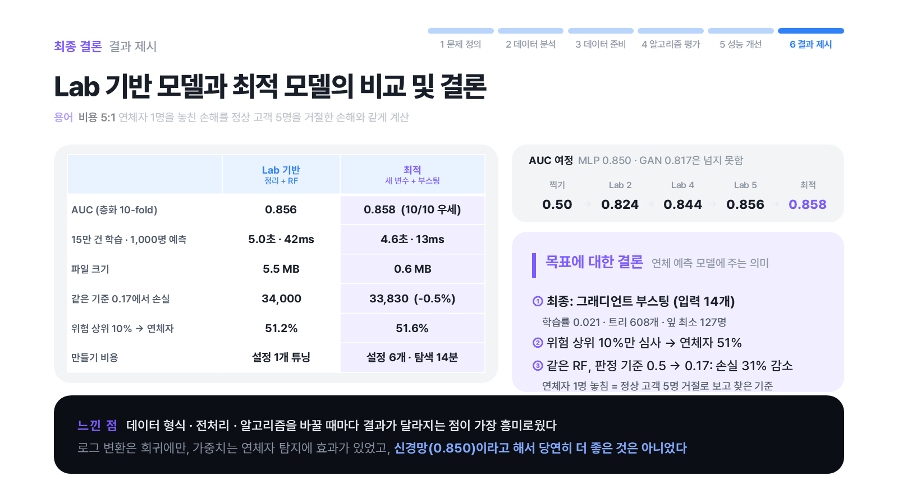
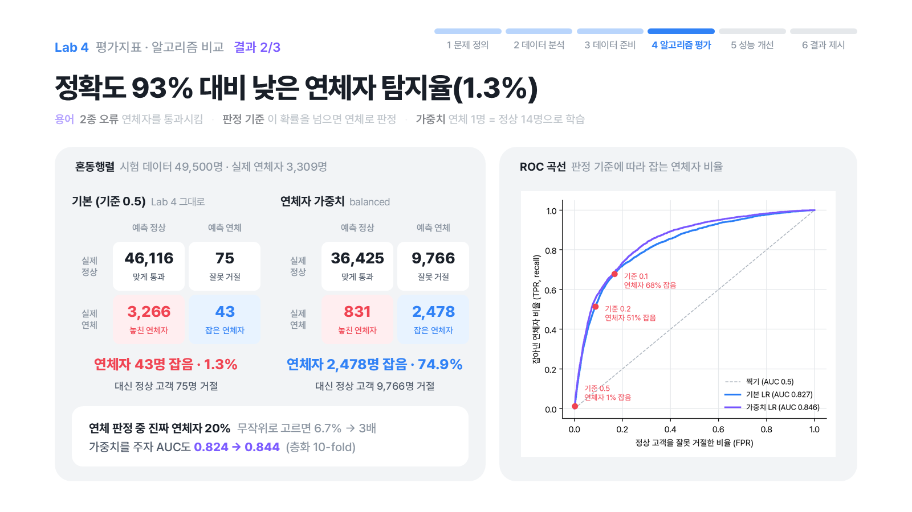
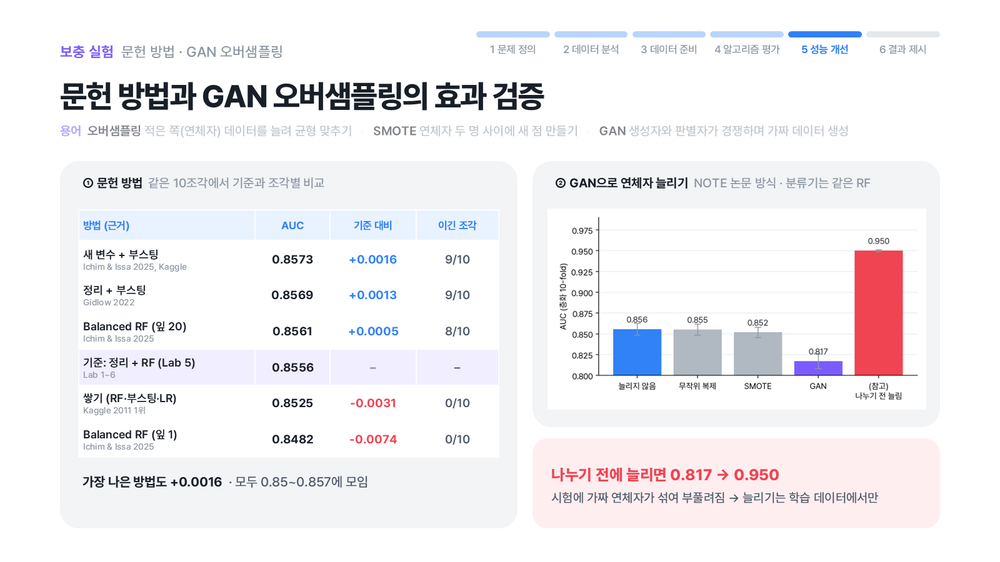

# 신용위험 예측 모델링 (Give Me Some Credit)

알고리즘분석 과제 · 수원대학교 컴퓨터SW학과 강희준

**15만 명의 금융 정보로 2년 안에 연체할 고객을 예측하는 모델을, 수업의 Lab 1~6 방법을 순서대로 적용해 만들고 7분 발표 자료로 정리한 과제입니다.**

[발표 자료 PDF](slides/credit_presentation.pdf) · [발표 대본](slides/script.md) · [실험 기록](results.md) · [진행 흐름](#진행-흐름) · [15만 건 처리](#15만-건을-어떻게-돌렸나) · [실행 방법](#실행-방법)



## 무엇을 하나요?

| 항목 | 내용 |
| --- | --- |
| 데이터 | Kaggle Give Me Some Credit (2011) 과제용 버전. 150,000행 × 9열 (입력 8개 + 정답) |
| 정답 | 2년 안에 90일 이상 연체했는지 (연체 10,026명, 6.68%) |
| 평가 지표 | AUC. 연체자가 6.68%뿐이라 모두 '정상'이라고 찍어도 정확도가 93.3%가 나오기 때문 |
| 진행 방식 | Lab 1 → Lab 6 순서대로, 한 Lab에서 발견한 문제가 다음 Lab의 질문이 되도록 |
| 필수 조건 | MLP 사용, 15만 건을 어떻게 학습시킬지 고민한 과정 포함 |

발표 자료의 모든 숫자는 [results.md](results.md)에 기록했고, 노트북을 다시 실행하면 같은 값이 나옵니다(seed 7).

## 결과 요약

| 단계 | 모델 | AUC (층화 10-fold) | 바뀐 점 |
| --- | --- | ---: | --- |
| 기준 | 모두 '정상'으로 찍기 | 0.500 | |
| Lab 2 | 로그+표준화 + 로지스틱 회귀 | 0.824 | 치우친 4개 변수에 로그 변환 |
| Lab 4 | + 연체자 가중치 | 0.844 | 연체자를 잡는 비율 1.3% → 75% |
| Lab 5 | 데이터 정리 + 랜덤 포레스트 (잎 최소 176명) | 0.856 | 트리가 학습 데이터를 외우지 못하게 제한 |
| Lab 6 | MLP (12-8, 배치 128, EarlyStopping) | 0.850 | 랜덤 포레스트를 넘지 못함 |
| 보충 | 새 변수 + 튜닝한 그래디언트 부스팅 | **0.858** | 10조각 모두 우세, 차이는 +0.002 |

- 정확도 93%인 로지스틱 회귀가 실제로는 연체자 3,309명 중 43명만 잡고 있었습니다. 학습할 때 연체자에 가중치를 주자 75%를 잡았고 AUC도 올랐습니다.
- MLP, 랜덤 포레스트, 그래디언트 부스팅이 모두 0.85~0.858에 모였습니다. 모델을 바꿔서 얻을 몫은 거의 남지 않았고, 이 데이터 8개 변수의 한계에 가깝다고 판단했습니다.
- GAN으로 연체자 데이터를 만들어 늘리면 0.817로 오히려 떨어졌습니다. 같은 GAN도 데이터를 나누기 전에 늘리면 시험에 가짜 연체자가 섞여 0.950이 나왔습니다.
- 위험 점수 상위 10%의 고객에 전체 연체자의 51%가 모여 있습니다. 연체자 1명을 놓친 손실을 정상 고객 5명을 거절한 손실과 같다고 보면, 판정 기준을 0.5가 아닌 0.17로 둘 때 손실이 31% 줄어듭니다.

## 진행 흐름

| Lab | 질문 | 한 일 | 발견 → 다음 질문 |
| --- | --- | --- | --- |
| 1 데이터 로딩·기술통계 | 데이터가 어떻게 생겼나? | 기술통계, 클래스 분포, 상관, 왜도 | 연체 6.7%, 소득 대체값(6638/6746) 29,737행, 불가능한 연체 횟수(96/98) 269행 → 값을 어떻게 바꿔야 하나? |
| 2 시각화·데이터 준비 | 어떤 변환이 맞나? | 분포 그림, MinMax·표준화·Normalizer·Binarizer·로그 비교 | 로그+표준화는 회귀에만, Binarizer는 트리에만 효과 → 변수가 다 필요한가? 평가는 믿을 만한가? |
| 3 특성 선택·리샘플링 | 변수를 줄일까? 어떻게 시험할까? | SelectKBest, RFE, PCA, 트리 중요도 / 분할, k-fold, LOOCV, ShuffleSplit | 줄여도 이득 없음, 한 번 분할은 0.816~0.828로 흔들림 → 층화 10-fold로 통일 |
| 4 평가지표·알고리즘 비교 | 무엇으로 재고 무엇을 고르나? | 정확도·logloss·AUC·혼동행렬, LR·LDA·KNN·CART·NB·SVM | 연체자 43명만 잡던 문제를 가중치로 해결, 선형 모델이 강함 → 더 올릴 수 있나? |
| 5 파이프라인·앙상블·튜닝 | 누수는 없었나? 더 올릴 수 있나? | Pipeline, Bagging·RF·AdaBoost·Voting, Grid·Random Search, 모델 저장 | 누수 영향 없음(0.8436 그대로), 잎 크기 튜닝으로 0.856 → 신경망은 넘을까? |
| 6 Keras MLP | 15만 건으로 어떻게 학습시키나? | 배치 5종 × 150 에폭 측정, 10-fold, KerasClassifier, Grid Search | 배치 128을 골라 13배 단축, MLP 0.850 |
| 보충 | 문헌의 방법을 쓰면? | 새 변수, 부스팅, Balanced RF, 쌓기, GAN 오버샘플링 | 부스팅만 근소하게 우세(+0.002), 늘리기는 효과 없음 |

각 Lab은 발표 자료에서 진행 → 결과 → 발견·결론의 3장으로 구성했습니다.



## 15만 건을 어떻게 돌렸나

Lab 자료의 예제는 768건짜리 데이터 기준이라, 15만 건에 그대로 쓰면 오래 걸리는 단계가 있었습니다. 먼저 시간을 재고 그 숫자로 방법을 정했습니다.

| 단계 | Lab 그대로 쓰면 | 한 일 |
| --- | --- | --- |
| Lab 3 LOOCV | 1회 학습 0.49초 × 15만 회 ≈ 20시간, AUC 계산 불가 | 1,000건 표본으로만 확인 |
| Lab 4 SVM | 데이터 2배에 시간 약 4배, 10-fold 약 1시간 | 1만 건 층화 표본에서 6개 알고리즘을 함께 비교 |
| Lab 6 MLP | 배치 10 · 150 에폭이면 모델 1개 26분, 10-fold 약 6시간 | 배치 5종을 150 에폭까지 모두 측정해 배치 128 선택 |
| Lab 6 Grid Search | 54가지 × 3-fold, 이틀 이상 | 배치와 에폭은 위 실험과 EarlyStopping으로 정하고 optimizer × 초기화 6가지만 탐색 |

배치 크기 실험 결과(검증 AUC / 누적 학습 시간):

| 배치 | 1 에폭 | 10 에폭 | 50 에폭 | 150 에폭 |
| --- | --- | --- | --- | --- |
| 10 (Lab) | 0.848 / 11초 | 0.853 / 90초 | 0.854 / 447초 | 0.854 / 26분 |
| 128 | 0.841 / 1.3초 | 0.851 / 9초 | 0.852 / 40초 | 0.854 / 124초 |
| 2048 | 0.566 / 0.7초 | 0.843 / 1.6초 | 0.850 / 5.8초 | 0.851 / 16초 |

배치 크기는 성능보다 시간을 결정했습니다. 150 에폭에서 다섯 배치 모두 0.851~0.855였습니다.


## 보충 실험과 최종 비교

Lab 과정으로 만든 모델이 어디쯤인지 확인하려고, 문헌에서 이 데이터에 효과가 있었다고 보고한 방법을 같은 기준으로 하나씩 더해 봤습니다. 같은 10조각에서 기준 모델과 조각별 차이를 계산했습니다.

| 방법 | AUC | 기준 대비 | 이긴 조각 |
| --- | ---: | ---: | ---: |
| 새 변수 + 그래디언트 부스팅 | 0.8573 | +0.0016 | 9/10 |
| Balanced RF (잎 20) | 0.8561 | +0.0005 | 8/10 |
| 기준: 데이터 정리 + RF (Lab 5) | 0.8556 | | |
| 쌓기 (RF·부스팅·LR → LR) | 0.8525 | -0.0031 | 0/10 |
| GAN으로 연체자 늘리기 + RF | 0.8172 | -0.0384 | 0/10 |

효과가 있던 방법만 모아 설정을 더 넓게 찾은 모델을 중첩 교차검증(설정은 각 조각의 학습 데이터 안에서만 탐색)으로 평가했습니다.

| | Lab 기반 (정리 + RF) | 최적 (새 변수 + 부스팅) |
| --- | --- | --- |
| AUC | 0.8556 | 0.8576 (10조각 모두 우세) |
| 15만 건 학습 · 1,000명 예측 | 5.0초 · 42ms | 4.6초 · 13ms |
| 파일 크기 | 5.5 MB | 0.6 MB |
| 손실 (비용 5:1, 기준 0.17) | 34,000 | 33,830 (-0.5%) |

최적 모델이 근소하게 낫지만, 은행 손실로 보면 차이는 0.5%입니다. 실무에서는 모델 선택보다 판정 기준값을 어떻게 정하느냐가 손실에 더 큰 영향을 줬습니다.



## 저장소 구성

```
credit_project/
├── notebooks/                 실험 노트북 (번호 순서대로 실행)
│   ├── 01_lab1_loading_stats.ipynb
│   ├── 02_lab2_preparing_data.ipynb
│   ├── 03_lab3_feature_selection_resampling.ipynb
│   ├── 04_lab4_metrics_algorithms.ipynb
│   ├── 05_lab5_pipeline_ensemble_tuning.ipynb
│   ├── 05b_lab5_final_model_full.ipynb      최종 RF를 15만 건 전체로 학습
│   ├── 06a_batch_epoch_experiment.py        배치 × 에폭 실험 (끊겨도 이어서 실행)
│   ├── 06_lab6_mlp.ipynb
│   ├── 07_literature_models.ipynb           보충: 문헌 방법
│   ├── 08_gan_oversampling.ipynb            보충: GAN 오버샘플링
│   ├── 09_optimal_vs_lab.ipynb              최종 비교, 비용 기준 판정값
│   ├── keras_wrapper.py                     Keras 3용 KerasClassifier
│   └── *.csv                                조각별 점수 등 실험 결과
├── figures/                   노트북이 만든 그림, Lab 자료 캡처(lab_captures/)
├── slides/
│   ├── build_deck.py          발표 자료 생성 (python-pptx)
│   ├── finalize.ps1           진입 애니메이션 추가, 글꼴 포함 저장, PDF 내보내기
│   ├── lab_capture.py         Lab PDF에서 코드 부분 캡처
│   ├── credit_presentation.pptx / .pdf
│   └── script.md              7분 대본과 예상 질문 (build_deck.py가 함께 생성)
├── docs/images/               README용 슬라이드 이미지
├── results.md                 모든 실험 숫자 기록
└── requirements.txt
```

## 실행 방법

**준비물: Python 3.13, Windows (발표 자료의 애니메이션·PDF 단계는 PowerPoint 필요).**

```sh
python -m venv .venv
.venv\Scripts\activate
pip install -r requirements.txt
python -m ipykernel install --user --name credit-project
```

1. 과제용 데이터 파일을 `data/givemesomecredit.csv`에 둡니다. Kaggle 데이터라 저장소에는 넣지 않았습니다. 첫 줄이 열 이름이고, 열은 `SeriousDlqin2yrs, RevolvingUtilizationOfUnsecuredLines, age, NumberOfTime30-59DaysPastDueNotWorse, DebtRatio, MonthlyIncome, NumberOfDependents, CombinedDefaulted, CombinedCreditLoans` 순서입니다.
2. 노트북을 번호 순서대로 실행합니다. 커널은 `credit-project`입니다.
   ```sh
   cd notebooks
   jupyter nbconvert --to notebook --execute --inplace --ExecutePreprocessor.kernel_name=credit-project 01_lab1_loading_stats.ipynb
   ```
   오래 걸리는 것: 05 약 20분, 06a 약 1시간, 06 약 50분, 07 약 40분, 09 약 15분 (CPU 기준).
3. 발표 자료를 만듭니다. 글꼴은 [Pretendard](https://github.com/orioncactus/pretendard)를 씁니다.
   ```sh
   cd slides
   python build_deck.py
   powershell -ExecutionPolicy Bypass -File finalize.ps1
   ```

## 알려진 한계

- 과제용 데이터는 원본 Kaggle 데이터의 연체 횟수 3개 열을 0/1 하나로 합친 버전이라, 원본으로 한 연구(최고 약 0.87)와 숫자를 직접 비교하지 않았습니다.
- 비용 비율 5:1은 신용평가 연구에서 흔히 쓰는 가정입니다. 실제 은행의 대출 금액과 이자 수익으로 정하면 기준값이 달라집니다.
- GAN은 Lecture 7의 기본 구조로 단순화했습니다. 교수님 논문(NOTE)의 오토인코더 + 조건부 WGAN과는 다르므로, 그 논문 결과를 재현한 것이 아닙니다.
- 날짜 정보가 없어서 다른 시기의 고객에게도 같은 성능이 나오는지는 확인할 수 없습니다.

## 개발 방식

이 저장소의 코드와 발표 자료는 AI 코딩 도구(Claude)와 함께 작성했습니다. 커밋의 `Co-Authored-By`가 그 기록입니다.

발표의 구성(Lab 순서대로 발견이 다음 질문으로 이어지는 흐름), 장표마다 넣을 내용, 실험 방향은 직접 정했습니다. 예를 들어 Lab 6에서 배치 크기를 128로 고른 것, 최종 모델을 15만 건 전체로 다시 학습한 것, 학습 시간을 성능 비교에 넣은 것, 문헌 방법과 GAN을 시험해 Lab 모델과 비교한 것이 그렇습니다.

결과를 믿을 수 있도록 다음을 지켰습니다.

- 모든 비교를 같은 층화 10-fold(seed 7)로 하고, 차이가 흔들림보다 작으면 우열을 주장하지 않았습니다.
- 전처리와 데이터 늘리기는 각 조각의 학습 데이터 안에서만 했습니다.
- 오래 걸리는 노트북은 작은 표본으로 먼저 끝까지 돌려 오류를 확인한 뒤 전체를 실행했습니다.
- 발표 자료의 숫자는 [results.md](results.md)와 노트북 출력에서만 가져왔습니다.

## 참고 자료

- 알고리즘분석 Lab 1~6, Lecture 2~7 (수원대학교 한성일 교수)
- Han, S. et al. (2024). NOTE: non-parametric oversampling technique for explainable credit scoring. *Scientific Reports*, 14, 26070.
- Han, S., Jung, H. (2024). NATE: Non-pArameTric approach for Explainable credit scoring on imbalanced class. *PLOS ONE*, 19(12).
- Ichim, B., Issa, B. (2025). Improving Machine Learning Performance in Credit Scoring by Data Analysis and Data Pre-Processing. *ICAART 2025*.
- [Kaggle: Give Me Some Credit (2011)](https://www.kaggle.com/competitions/GiveMeSomeCredit)
